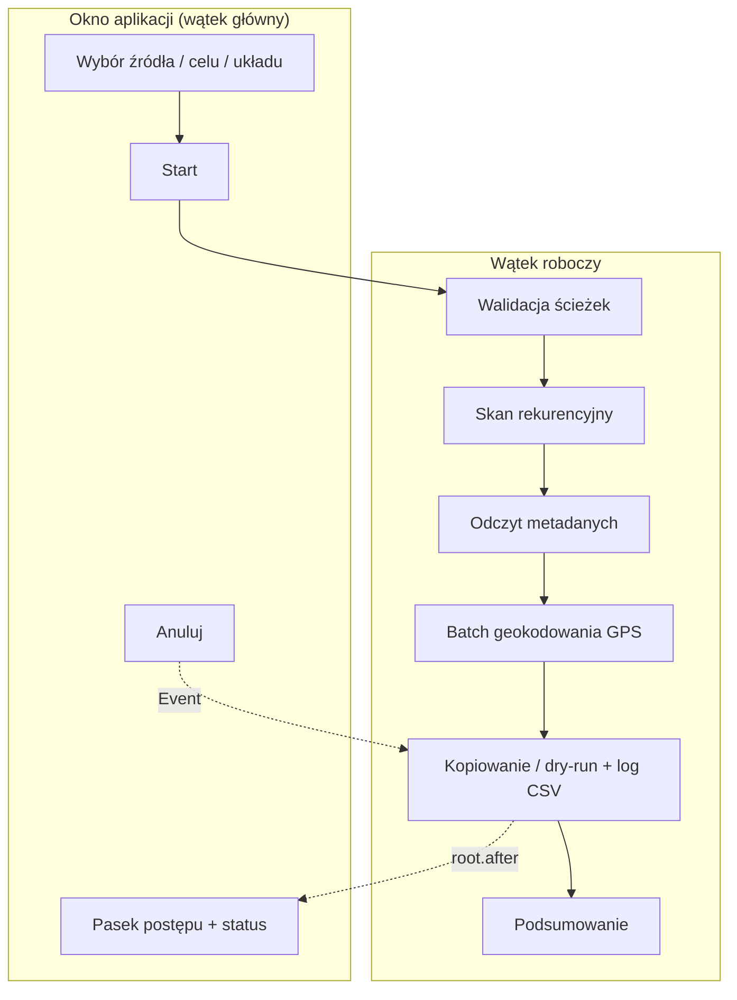
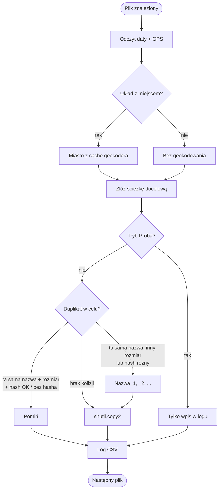
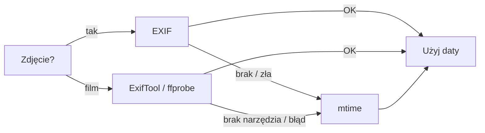

# Photo Sorter

**Lokalna aplikacja Windows i macOS** do porządkowania dużych bibliotek zdjęć i filmów.

### Uruchomienie na MacBooku

Główny plik aplikacji to `photo_sorter.py`. Plik `photo_sorter (1).py` jest starszą wersją.

Do uruchomienia ze źródeł potrzebny jest Python 3.11 lub nowszy z obsługą Tkinter
(np. instalator macOS z [python.org](https://www.python.org/downloads/macos/)).
W Terminalu, w folderze repozytorium:

```bash
python3 -m venv .venv
.venv/bin/python -m pip install -r requirements.txt
.venv/bin/python photo_sorter.py
```

Żeby przygotować samodzielną aplikację uruchamianą dwuklikiem:

```bash
bash scripts/build_macos.sh
```

W Finderze otwórz `dist/macos/PhotoSorter.app`. Możesz skopiować ją do folderu
Programy. Gotowa aplikacja zawiera Pythona i biblioteki; Terminal jest potrzebny
tylko do jej zbudowania. Paczka ma architekturę Pythona użytego do budowania
(na Macu Apple Silicon zwykle arm64). Wersję Windows nadal buduje `PhotoSorter.spec`
na Windows, a wersję macOS — `packaging/macos.spec` na Macu.

Pierwsze sortowanie warto uruchomić z opcją **Tylko sprawdź, nic nie kopiuj**.
Ustawienia macOS zapisują się w `~/Library/Application Support/PhotoSorter/`.
Opcjonalne narzędzia `exiftool` lub `ffprobe` poprawiają odczyt dat filmów;
bez nich program korzysta z pozostałych źródeł dat. Nie są dołączone do paczki.
Wersja uruchamiana z Findera może wymagać dodania ich do PATH środowiska aplikacji.

Lokalna paczka nie jest podpisana certyfikatem Developer ID ani notaryzowana.
Przy publicznej dystrybucji należy przygotować podpis i notaryzację dla macOS.

Skanuje wybrany folder **rekurencyjnie**, odczytuje datę wykonania i (opcjonalnie) lokalizację GPS, a następnie **kopiuje** pliki do folderu docelowego w układzie zgodnym z aplikacją **UGREEN Sync & Backup** — domyślnie:

```text
<folder docelowy>\<nazwa urządzenia>\RRRR\MM\
```

np. `D:\Backup\Photos\MobileBackup\samsung SM-S908B\2024\04\IMG_1234.jpg`

Program **niczego nie przenosi i nie usuwa**. Oryginały zostają nietknięte. Interfejs jest po polsku, minimalny, bez kont, chmury i telemetrii.

| | |
|---|---|
| Platforma | Windows 11 (Python 3.11+ albo gotowy `.exe`) |
| Formaty | JPG, JPEG, PNG, HEIC/HEIF, WEBP, MP4, MOV, 3GP, MKV |
| Sieć | Offline (GPS → miasto lokalnie przez `reverse_geocoder`) |
| Bezpieczeństwo | Tylko kopiowanie (`shutil.copy2`), bez kasowania |
| Wznawianie | Ponowny start pomija już skopiowane pliki (nazwa + rozmiar) |

---

## Spis treści

1. [Po co to jest](#1-po-co-to-jest)
2. [Jak to działa — big picture](#2-jak-to-działa--big-picture)
3. [Przepływ przetwarzania jednego pliku](#3-przepływ-przetwarzania-jednego-pliku)
4. [Skąd bierze się data](#4-skąd-bierze-się-data)
5. [GPS i lokalizacja](#5-gps-i-lokalizacja)
6. [Układy folderów](#6-układy-folderów)
7. [Duplikaty i wznawianie](#7-duplikaty-i-wznawianie)
8. [Tryb Próba (dry run)](#8-tryb-próba-dry-run)
9. [Log CSV](#9-log-csv)
10. [Interfejs](#10-interfejs)
11. [Instalacja (Python)](#11-instalacja-python)
12. [Gotowy plik .exe](#12-gotowy-plik-exe)
13. [Budowanie .exe samodzielnie](#13-budowanie-exe-samodzielnie)
14. [Konfiguracja i pliki na dysku](#14-konfiguracja-i-pliki-na-dysku)
15. [UGREEN Sync & Backup — ważna uwaga](#15-ugreen-sync--backup--ważna-uwaga)
16. [Plan testów](#16-plan-testów)
17. [Rozwiązywanie problemów](#17-rozwiązywanie-problemów)
18. [Struktura projektu](#18-struktura-projektu)
19. [Rozszerzanie (nowe układy)](#19-rozszerzanie-nowe-układy)
20. [Licencja / założenia](#20-licencja--założenia)

---

## 1. Po co to jest

Typowy scenariusz:

1. Masz bałagan: dysk zewnętrzny, stary telefon, eksport z Google Photos, folder „Do posortowania”.
2. Chcesz mieć porządek jak na NAS UGREEN: `Photos\MobileBackup\<telefon>\rok\miesiąc`.
3. Potem ręcznie (albo Sync) dokładasz nowe zdjęcia z telefonu do tych samych folderów.

Photo Sorter robi krok 2 **lokalnie**, szybko, z logiem i możliwością „próby” zanim cokolwiek skopiuje.

```text
  [bałagan lokalny]          Photo Sorter              [ładny układ]
  D:\Stare\*.jpg      ──────────────────────►   D:\Posortowane\
  E:\Telefon\DCIM\            KOPIUJE               └── samsung SM-S908B\
  F:\Export\2022\                                   ├── 2023\11\
                                                    └── 2024\04\
```

---

## 2. Jak to działa — big picture



**Zasady wątków**

- Okno **nigdy nie powinno się zawiesić** — ciężka praca idzie w osobnym wątku.
- Aktualizacje GUI tylko przez `root.after` (bezpiecznie z wątku roboczego).
- **Anuluj** ustawia flagę; program kończy bieżący plik i wychodzi z pętli (bez urwania w połowie `copy2` w sposób destrukcyjny — po prostu nie bierze kolejnych).

---

## 3. Przepływ przetwarzania jednego pliku



---

## 4. Skąd bierze się data

Kolejność źródeł (pierwsze poprawne wygrywa):

| Priorytet | Źródło | Kiedy | Wartość w logu `zrodlo_daty` |
|-----------|--------|--------|------------------------------|
| 1 | EXIF `DateTimeOriginal`, potem `DateTime` | Zdjęcia | `exif` |
| 2 | ExifTool / ffprobe (QuickTime CreationDate, CreateDate, …) | Filmy, jeśli narzędzie jest w PATH | `metadane` |
| 3 | Data modyfikacji pliku (`mtime`) | Fallback | `plik` |

**Odrzucane jak „brak daty”** (wtedy spadamy niżej / na `mtime`):

- `0000:00:00…`
- daty z roku &lt; 1971 (w tym klasyczne `1970-01-01`)
- daty z przyszłości (z małym zapasem 2 dni)



> **Wskazówka:** do lepszych dat filmów zainstaluj [ExifTool](https://exiftool.org/) albo `ffprobe` (FFmpeg) i dodaj do PATH systemu.

---

## 5. GPS i lokalizacja

1. Ze zdjęcia wyciągane są współrzędne EXIF (obsługa półkul S/W, wartości `IFDRational` i krotek).
2. Współrzędne są **zaokrąglane** i zbierane w batch.
3. Jedno wywołanie **offline** `reverse_geocoder` mapuje je na miasto.
4. **Nic nie jest wysyłane do internetu.**

Gdy układ wymaga miejsca, a GPS nie ma / geokoder nie da wyniku → folder:

```text
Bez lokalizacji
```

---

## 6. Układy folderów

Wybierane z listy w GUI (łatwo dodać nowe w słowniku `MODES` w kodzie):

| Układ w programie | Przykład ścieżki względem bazy |
|-------------------|--------------------------------|
| `Rok\MM (np. 2024\04) — jak UGREEN` | `2024\04\` |
| `Rok (np. 2024)` | `2024\` |
| `Rok\MM\Dzień (np. 2024\04\15)` | `2024\04\15\` |
| `Rok\Miejsce (np. 2024\Warszawa)` | `2024\Warszawa\` |
| `Rok\MM\Miejsce (np. 2024\04\Warszawa)` | `2024\04\Warszawa\` |

**Baza ścieżki**

```text
<folder docelowy>
```

albo, gdy podasz podfolder urządzenia:

```text
<folder docelowy>\<oczyszczona nazwa urządzenia>
```

Nazwa urządzenia jest czyszczona ze znaków niedozwolonych w Windows: `<>:"/\|?*`.

### Przykład zgodny z UGREEN

| Pole | Wartość |
|------|---------|
| Folder docelowy | `D:\NAS_kopia\Photos\MobileBackup` |
| Podfolder urządzenia | `samsung SM-S908B` |
| Układ | `Rok\MM … jak UGREEN` |

Wynik dla zdjęcia z kwietnia 2024:

```text
D:\NAS_kopia\Photos\MobileBackup\samsung SM-S908B\2024\04\DSC_0001.jpg
```

---

## 7. Duplikaty i wznawianie

| Sytuacja w folderze docelowym | Zachowanie |
|-------------------------------|------------|
| Ta sama nazwa **i** ten sam rozmiar | **Pomiń** (uznaj za już skopiowany) |
| Ta sama nazwa, **inny** rozmiar | Zapisz jako `nazwa_1.ext`, `nazwa_2.ext`, … |
| Ta sama nazwa + rozmiar, **hash włączony**, hashe różne | Traktuj jak inny plik → `_1`, `_2`, … |
| Ta sama nazwa + rozmiar, hash włączony, hashe równe | Pomiń |

Checkbox **„Porównuj hash…”** jest **domyślnie wyłączony** (SHA-256 po sieci / dużych plikach jest wolny).

Dzięki regule nazwa+rozmiar **ponowne uruchomienie po przerwaniu kontynuuje bez duplikatów** — już skopiowane pliki są pomijane.

---

## 8. Tryb Próba (dry run)

Zaznacz **„Próba (nic nie kopiuj, tylko zapisz log)”**.

| Robi | Nie robi |
|------|----------|
| Skanuje pliki | Nie tworzy drzewa katalogów docelowych |
| Czyta metadane / GPS | Nie kopiuje plików |
| Zapisuje log CSV ze statusem `proba` / `pominiety…` | Nie zmienia oryginałów |

Przed startem program sprawdza, że **folder docelowy istnieje i jest zapisywalny** (probe-plik testowy), ale w samej próbie nie buduje układu `rok\miesiąc`.

---

## 9. Log CSV

- Kodowanie: **UTF-8 z BOM** (`utf-8-sig`) — dobrze otwiera się w Excelu.
- Separator: **`;`**
- Nazwa: `photo_sorter_log_YYYYMMDD_HHMMSS.csv`
- Lokalizacja: **folder źródłowy**  
  jeśli źródło jest tylko do odczytu → `%APPDATA%\PhotoSorter\`

Kolumny:

| Kolumna | Opis |
|---------|------|
| `plik` | Ścieżka źródłowa |
| `data` | Użyta data wykonania |
| `zrodlo_daty` | `exif` / `metadane` / `plik` |
| `lat` / `lon` | Współrzędne (jeśli są) |
| `miejsce` | Opis z geokodera |
| `cel` | Docelowa ścieżka lub folder |
| `status` | `skopiowany` / `pominiety (juz jest)` / `proba` / `blad: …` |

Na końcu: podsumowanie **skopiowano / pominięto / błędy**. Błąd jednego pliku **nie przerywa** całej operacji.

---

## 10. Interfejs

```text
┌─────────────────────────────────────────────────────────────┐
│  Photo Sorter                                               │
├─────────────────────────────────────────────────────────────┤
│  Folder ze zdjęciami (razem z podfolderami):                │
│  [________________________________________]  [Wybierz]      │
│                                                             │
│  Folder docelowy:                                           │
│  [________________________________________]  [Wybierz]      │
│                                                             │
│  Podfolder urządzenia (opcjonalnie…):                       │
│  [________________________________________]                 │
│                                                             │
│  Układ folderów:                                            │
│  [ Rok\MM (np. 2024\04) — jak UGREEN      ▼ ]               │
│                                                             │
│  ☐ Porównuj hash przy duplikatach (wolniejsze)              │
│  ☐ Próba (nic nie kopiuj, tylko zapisz log)                 │
│                                                             │
│            [ Start ]    [ Anuluj ]                          │
│  [████████████████░░░░░░░░░░░░░░░░░░░░░░]                   │
│  Status: 128/1500                                           │
└─────────────────────────────────────────────────────────────┘
```

Ostatnie ustawienia (ścieżki, układ, hash) są zapamiętywane w:

```text
%APPDATA%\PhotoSorter\config.json
```

---

## 11. Instalacja (Python)

Wymagania: **Windows 11**, **Python 3.11+**.

```powershell
cd E:\PhtotoSorterLoc
python -m venv .venv
.\.venv\Scripts\Activate.ps1
pip install pillow pillow-heif reverse_geocoder
python photo_sorter.py
```

### Opcjonalnie (lepsze daty filmów)

- **ExifTool** — dodaj katalog z `exiftool.exe` do PATH  
- **ffprobe** (pakiet FFmpeg) — również w PATH  

Program działa też bez nich; wtedy filmy najczęściej dostaną datę z pliku (`zrodlo_daty=plik`).

---

## 12. Gotowy plik .exe

Po zbudowaniu:

```text
E:\PhtotoSorterLoc\dist\PhotoSorter.exe
```

Uruchomienie: dwuklik. **Nie trzeba instalować Pythona** na docelowym PC.

> Windows SmartScreen / antywirus może ostrzec przy pierwszym uruchomieniu niesygnowanego `.exe` z PyInstallera. To normalne dla amatorskich buildów.  
> Ścieżka: *Więcej informacji* → *Uruchom mimo to*.  
> Na stałe: podpis kodu (code signing) albo wykluczenie folderu w AV.

---

## 13. Budowanie .exe samodzielnie

### Pierwszy raz (pełna komenda)

```powershell
pip install pyinstaller
cd E:\PhtotoSorterLoc
pyinstaller --noconfirm --onefile --windowed --name PhotoSorter `
  --hidden-import=PIL --hidden-import=pillow_heif --hidden-import=reverse_geocoder `
  --collect-all reverse_geocoder --collect-all pillow_heif `
  photo_sorter.py
```

Powstanie m.in.:

| Ścieżka | Co to jest |
|---------|------------|
| `dist\PhotoSorter.exe` | Gotowa aplikacja |
| `PhotoSorter.spec` | Przepis builda (do powtórek) |
| `build\` | Cache PyInstallera (można kasować) |

### Kolejne buildy (po zmianie kodu)

```powershell
pyinstaller --noconfirm PhotoSorter.spec
```

To **nadpisuje** `dist\PhotoSorter.exe` według zapisanego `.spec`.

### Jak ograniczyć fałszywe alarmy AV

1. Preferuj `--onedir` zamiast `--onefile`, jeśli dystrybuujesz w zaufanym gronie (mniej heurystyk „paczki self-extract”).
2. Nie pakuj zbędnego softu do tego samego exe.
3. Trzymaj stałą nazwę i wydawcę; idealnie — **podpis cyfrowy**.
4. Wrzuć folder projektu / `dist` na listę wykluczeń w Windows Defender na czas developmentu.

---

## 14. Konfiguracja i pliki na dysku

```text
%APPDATA%\PhotoSorter\
├── config.json              ← ostatnie ścieżki / układ / hash
└── photo_sorter_log_*.csv   ← logi, gdy źródło jest read-only
```

Przykład `config.json`:

```json
{
  "src": "D:\\DoPosortowania",
  "dst": "D:\\Posortowane\\Photos\\MobileBackup",
  "dev": "samsung SM-S908B",
  "mode": "Rok\\MM (np. 2024\\04) — jak UGREEN",
  "use_hash": false
}
```

---

## 15. UGREEN Sync & Backup — ważna uwaga

Nie wiadomo z góry, czy Sync na telefonie uzna pliki wgrane Photo Sorterem za „już istniejące”, czy wyśle je ponownie.

**Mini-test (zalecany):**

1. Skopiuj **3–5 zdjęć** tym programem do  
   `Photos\MobileBackup\<urzadzenie>\RRRR\MM`.
2. Zapisz liczbę plików / rozmiar folderu.
3. Uruchom Sync z telefonu dla tych samych zdjęć.
4. Sprawdź, czy liczba/rozmiar mocno urośnie (ponowna wysyłka) albo zostanie bez zmian.

Jeśli Sync dubluje — rozważ wgrywanie do osobnej gałęzi albo czyszczenie duplikatów po syncu.

---

## 16. Plan testów

Przygotuj mały zestaw **10–20 plików**:

| # | Plik | Czego szukasz |
|---|------|----------------|
| 1 | HEIC z iPhone | Otwarcie + data EXIF |
| 2 | JPG z GPS | Folder miejsca / lat-lon w logu |
| 3 | JPG bez GPS | `Bez lokalizacji` (układy z miejscem) |
| 4 | MP4 / MOV | Data z metadanych lub `plik` |
| 5 | Screenshot PNG | Brak EXIF → data pliku |
| 6 | Nazwa z polskimi znakami i spacją | `Wakacje Gdańsk 2024.jpg` |
| 7 | Duplikat (ten sam plik 2×) | Drugi przebieg → pominięcie |
| 8 | Ta sama nazwa, inna treść/rozmiar | Sufiks `_1` |
| 9 | Przerwanie w połowie + Start | Wznowienie bez duplikatów |
| 10 | Tryb Próba | Log bez nowych folderów/kopii |
| 11 | Hash włączony | Różna treść, ten sam rozmiar → `_1` |
| 12 | (opcjonalnie) ścieżka UNC `\\IP\udział\...` | Program się nie wywala |

---

## 17. Rozwiązywanie problemów

| Objaw | Co sprawdzić |
|-------|----------------|
| „Folder źródłowy nie istnieje” | Literówka, odpięty dysk USB |
| „Folder docelowy nie istnieje albo nie można zapisać” | Utwórz folder, sprawdź uprawnienia / pełny dysk |
| Filmy mają dziwną datę | Zainstaluj ExifTool lub ffprobe w PATH |
| HEIC nie działa | `pip install pillow-heif` i przebuduj exe |
| Brak miast przy GPS | `pip install reverse_geocoder` |
| Excel psuje polskie znaki w logu | Otwieraj jako UTF-8 / użyj logu z BOM (już jest) |
| SmartScreen blokuje exe | *Więcej informacji* → uruchom mimo to |
| Długie ścieżki Windows | Program dokłada prefiks `\\?\` gdy trzeba |

Folder docelowy leżący **wewnątrz** źródłowego jest **pomijany** przy skanie (żeby nie kopiować w kółko własnego wyniku).

---

## 18. Struktura projektu

```text
PhtotoSorterLoc/
├── photo_sorter.py          ← kod źródłowy (to edytujesz)
├── photo_sorter (1).py      ← stara wersja / kopia (opcjonalnie)
├── PhotoSorter.spec         ← przepis PyInstallera
├── README.md                ← ten plik
├── dist/
│   └── PhotoSorter.exe      ← gotowa aplikacja
└── build/                   ← artefakty pośrednie PyInstallera
```

Główny plik do uruchomienia ze źródeł: **`photo_sorter.py`**.

---

## 19. Rozszerzanie (nowe układy)

W `photo_sorter.py` słownik `MODES`:

```python
MODES = {
    "Rok\\MM (np. 2024\\04) — jak UGREEN": lambda t, city: [f"{t.year}", f"{t.month:02d}"],
    # dodaj np.:
    "Rok\\Kwartał": lambda t, city: [f"{t.year}", f"Q{(t.month - 1) // 3 + 1}"],
}
```

Każda funkcja dostaje `datetime` i nazwę miasta (lub pusty string) i zwraca **listę segmentów ścieżki**.

Teksty UI są w słowniku `TXT` na górze pliku — łatwa lokalizacja / poprawki językowe.

---

## 20. Licencja / założenia

- Program jest **uniwersalny**: żadnych hardcodowanych nazw osób, NAS-ów ani udziałów.
- Przeznaczony głównie do **lokalnych folderów**; ścieżki UNC są obsługiwane defensywnie (nie powinny wywalać aplikacji), ale typowy workflow to sort lokalny → ręczne przeniesienie na NAS.
- Autor / użytkownik odpowiada za kopie zapasowe przed masowym kopiowaniem dużych bibliotek.

---

## Szybki start (TL;DR)

```powershell
# Wariant A — Python
pip install pillow pillow-heif reverse_geocoder
python photo_sorter.py

# Wariant B — gotowy exe
E:\PhtotoSorterLoc\dist\PhotoSorter.exe

# Wariant C — przebudowa exe po zmianach
pyinstaller --noconfirm PhotoSorter.spec
```

1. Wybierz folder ze zdjęciami.  
2. Wybierz folder docelowy.  
3. (Opcjonalnie) wpisz nazwę telefonu jak w UGREEN.  
4. Zostaw układ `Rok\MM … jak UGREEN`.  
5. Odpal najpierw **Próbę**, zerknij w CSV, potem prawdziwy **Start**.

Miłego porządkowania. 🗂️
